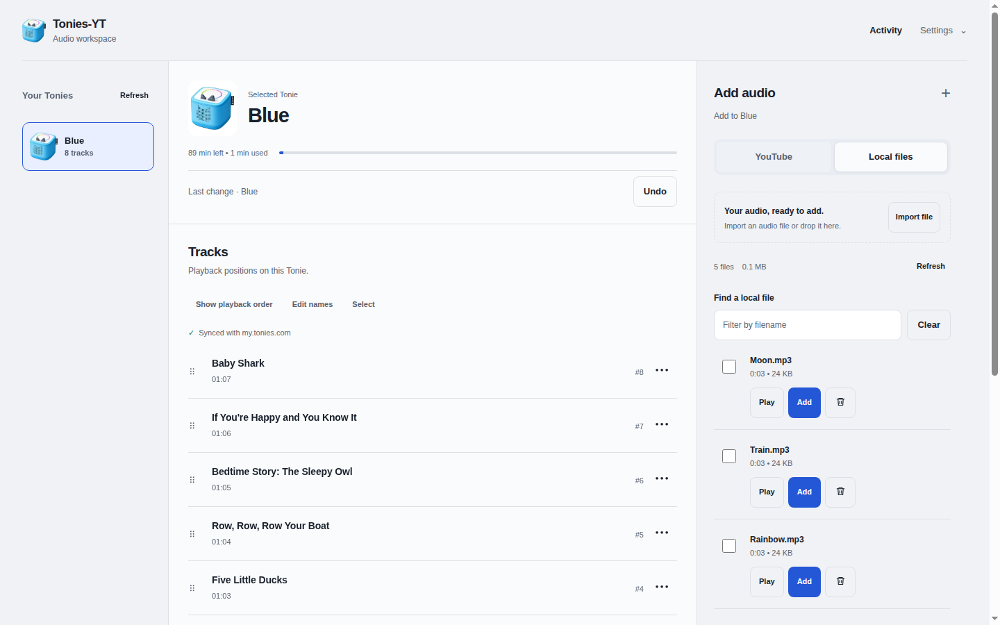

# Tonies-YT

Fast web app for managing Creative Tonies audio.

> **Unofficial.** Tonies-YT is a hobby project, not affiliated with or endorsed by tonies GmbH. It uses the same private web API as my.tonies.com, which can change without notice and break the app. "Tonies", "Toniebox" and "Creative-Tonie" are trademarks of tonies GmbH. Only upload audio you have the right to use.



## What it does
- Search YouTube, pick a result and download audio, or paste a playlist link and pick from its first 50 videos
- Select several results and add them in one go; they land in the order shown
- **Edit and clip** audio on a waveform before adding it: play it, drag the start and end, listen to the clip
- Every track is **volume-levelled** when it's added, so one song isn't quiet and the next one loud
- Upload audio to Creative Tonies through the Tonies cloud API
- Manage Tonies tracks: rename, reorder, delete, **delete all content with confirmation**
- Maintain a Local MP3 Library for drag/drop or upload-to-Tonies flows
- Preview local MP3s with **Play / Pause** on each row and one browser-native player for seeking and volume. Playback survives library refreshes and filtering; **Close**, deleting the playing file, or **Lock** stops it. Playback is local to your browser, never uploads to Tonies, and requires sign-in.
- Transfer up to three local uploads concurrently, with queued attachment order and pending-state highlighting
- Import local audio using **Import file**; it is converted to a Tonies-friendly MP3 once, on import
- Local files rows keep it simple: one tap to **Play** or **Add**; the **⋯** menu (or right-click / long-press) has Edit and clip, Add to top / bottom, Download and Delete. **Select** adds or deletes several files at once
- **Undo** the last rename, move or upload on a Tonie, and cancel a removal within five seconds

## Get started

You need [Docker](https://docs.docker.com/get-docker/) (Docker Desktop on Windows and macOS). Then, in a terminal:

```bash
mkdir tonies-yt && cd tonies-yt
curl -fsSLO https://raw.githubusercontent.com/c1rca/tonies-yt/main/docker-compose.yml
curl -fsSL https://raw.githubusercontent.com/c1rca/tonies-yt/main/.env.example -o .env
docker compose -p tonies-local up -d
```

On Windows PowerShell, type `curl.exe` instead of `curl`. This downloads the ready-made image (PCs and Raspberry Pis), so nothing is built.

Open **http://localhost:8090** on that computer, create an app login and enter your Tonies account.

**From your phone:** by default only that computer can open the app. Find the computer's address (for example `192.168.1.20`), then in `.env` set `TONIES_BIND_ADDRESS=192.168.1.20` and add it to `APP_ALLOWED_HOSTS` (`APP_ALLOWED_HOSTS=localhost,127.0.0.1,192.168.1.20`). Run `docker compose -p tonies-local up -d` again and open `http://192.168.1.20:8090`. This is plain HTTP, so only do it on a home network you trust; for anything wider use [a reverse proxy with HTTPS](docs/OPERATIONS.md#running-behind-a-reverse-proxy).

**Update:** `docker compose -p tonies-local pull && docker compose -p tonies-local up -d`. To stay on one version, set `TONIES_IMAGE_TAG=3.1.0` (for example) in `.env`.

## How it talks to Tonies

The app calls the Tonies cloud directly over HTTPS (`httpx`): OAuth login at `login.tonies.com`, then the same API the my.tonies.com web app uses. There is no browser, Playwright or Chromium involved.

- Changes queue up instead of waiting for each other. Delete, move or rename as fast as you like: the list updates straight away, and everything queued for a Tonie is saved together in one write (one read, one write, one confirming read).
- Uploads send their audio up to three at a time, alongside your edits, and land in the order you queued them, at the position you chose.
- Every change names tracks by their Tonies chapter ID, not by row number, so a queued edit still hits the right track after the list has moved. If a track is gone (for example deleted on another device) that one change fails and the rest still save.
- A write whose outcome is unknown (for example a timeout) is never retried automatically; the app asks you to refresh first.
- Uploads go straight to Tonies' storage with a presigned form; your login token is never sent there.
- OAuth tokens live in memory only and renew automatically. After a restart you sign in to the app again and the next Tonies action signs in to Tonies fresh.

## Security model

- Each browser signs in with the app username and password and gets its own session cookie (HttpOnly, SameSite=Strict). Application pages and APIs require it; minimal setup/sign-in/health routes and public static assets remain accessible.
- **Lock** (in the **Settings** menu) signs every browser out and locks the vault. Changing the app password signs other browsers out. A restart signs everyone out.
- Five wrong passwords from one address within five minutes trigger a wait. Writes sent from other websites are refused.
- Tonies credentials are encrypted with a vault key protected by the app password; OAuth tokens stay server-side in memory, never browser storage. New app passwords require at least 12 characters; existing vaults remain supported.
- The Docker image runs as **UID/GID 10001:10001**. Compose additionally makes code read-only, drops all capabilities, prevents privilege escalation and limits resources. There is no root startup/ownership-repair fallback.
- Compose exposes only **127.0.0.1:8090** by default. Finish setup locally before opting into remote access: the first visitor to an unconfigured app creates the login. **Use HTTPS outside localhost**, including shared LANs, and configure the exact allowed Host/origin and proxy trust. See [Security](docs/SECURITY.md) and [proxy instructions](docs/OPERATIONS.md#running-behind-a-reverse-proxy).

## Audio workspace

1. **Choose a Tonie.** Desktop keeps your Tonies in a compact rail. On mobile and tablet, use **Change Tonie** in the selected-target header. Capacity and the destination stay visible while you browse.
2. **Add audio.** Switch between **YouTube** and **Local files** without losing your search or file filter. Import a file with **Import file** or drop it on the import area. Use a row's **Add** button, or select several local files and use **Add to [Tonie]**. Each submission keeps the destination captured when you clicked it.
3. **Arrange tracks.** Playback positions identify the actual listening order. **Reverse display** changes only the view, not the Tonie. Every row has a visible **Actions** menu for Rename, Move up/down/top/bottom and Remove. Inline rename supports Enter to save and Escape to cancel; drafts survive background refreshes. **Select** enables a single confirmed batch removal. **Manage this Tonie** keeps Clear all separate from ordinary actions.
4. **Check Activity.** Jobs and library changes share one view, named by destination. Sending, queued attachment, saved attachment, cloud processing and refresh-needed states remain distinct. Partial failures stay visible until dismissed. Accepted uploads are not resubmitted when their follow-up refresh fails.
5. **Preview locally.** Play opens one persistent native audio dock, including seeking and volume. Changing views, sources or Tonies does not remount it. It is explicitly a local preview, not playback on your physical Tonie. Close, confirmed deletion of the playing local file and Lock stop playback.

Mobile has three primary destinations: **Tracks**, **Add audio**, and **Activity**. Desktop keeps Tracks and Add audio side by side. **Settings → Appearance** follows the system by default and remembers a manual light/dark choice; the Settings, Logs, Sign-in and Setup pages use the same appearance and look.

### Undo mistakes

The selected Tonie offers **Undo** only when the server has a valid capability for its latest submission. Confirmed Rename/Move and a newly attached upload can be reversed for up to ten minutes, provided the Tonie has not changed. Removal has a short **five-second cancellation window before it is sent**; after a cloud deletion is committed, the app does not claim it can recover the audio. Clear all is not recoverable.

Undo rechecks current chapter identities/order under the same target lock before one inverse write. A stale or unconfirmed outcome refuses further Undo and asks you to refresh—never blindly retries or restores a client-supplied library snapshot. A newer submission, Lock, account/password changes, expiry or restart revokes old capabilities. The provider has no proven compare-and-swap contract, so another device can still race the final read/write boundary.

### Where things live

Each area has its own small, named file; most start with a one-line comment saying what they own. `tests/test_no_monoliths.py` keeps every file in `app/`, `web/` and `web/assets/` at 400 lines or fewer and every Python or JS function at 100 lines or fewer.

#### Server: app start and pages
- `app/__init__.py`: the app version
- `app/main.py`: builds the FastAPI app: start-up and shutdown, security middleware, error handling and the routers
- `app/config.py`: settings read from the environment (Tonies account override, data folder, allowed hosts, public URL, upload limit, logging)
- `app/logger.py`: log setup (rotating log file, quiet HTTP client logs)
- `app/web_pages.py`: serves an HTML page with the shared version footer added
- `app/static_assets.py`: serves `web/`; versioned asset URLs (`?v=N`) are cached for good, others revalidate

#### Server: HTTP routes (`app/routes/`)
- `app/routes/__init__.py`: package marker for the routers
- `app/routes/setup.py`: health, first-run setup, sign-in, Lock, password and Tonies account changes, tool versions
- `app/routes/pages.py`: the HTML pages (workspace, Settings, Logs, Sign-in, Setup), the old `/account` redirect and the favicon
- `app/routes/jobs.py`: searches, picking one or several results, fetching a result for the editor, cancelling jobs
- `app/routes/files.py`: Local files: list, import, play/download, waveform, clip, delete, add to a Tonie
- `app/routes/tonies.py`: Creative Tonies list, track list reads, queued changes, Undo and the older single-change endpoints
- `app/routes/events.py`: the server-sent event stream, its statistics and the log viewer routes

#### Server: sign-in and security
- `app/auth.py`: per-browser sessions, sign-in throttling and cross-site write checks
- `app/request_security.py`: Host and Origin checks and request body size limits
- `app/credentials.py`: the password-protected vault holding the app login and the encrypted Tonies credentials
- `app/vault_storage.py`: private, atomic reads and writes of the vault files

#### Server: search and download jobs
- `app/models.py`: request and job data models
- `app/ai.py`: turns a typed search or link into a job request (plain rules, no AI service)
- `app/youtube_source.py`: checks and normalises YouTube video and playlist input
- `app/job_store.py`: job state, saving to disk, job events, cancelling, expiry and the stuck-job watchdog
- `app/job_pipeline.py`: running a search, picking results, the download pool (three at a time) and editor fetches
- `app/job_upload.py`: handing a finished download to the Tonie queue and following it to the end
- `app/attach_order.py`: hands parallel downloads to the Tonie queue in list order
- `app/downloader.py`: yt-dlp commands for search, playlists and downloads (one retry for a plain failure)
- `app/events.py`: the shared event list behind `/api/events`, for jobs and Tonies changes

#### Server: audio and Local files
- `app/media_files.py`: the Local files library: safe file names, imports, waveforms and clips
- `app/media_process.py`: ffmpeg/ffprobe work: the one MP3 encoder (with volume levelling), waveform outlines, lossless clips and durations
- `app/subprocess_runner.py`: runs a child process with a deadline and bounded output, and cleans it up

#### Server: Tonies cloud
- `app/uploader.py`: the app-facing Tonies operations; keeps one client per account and resets it when the vault locks or credentials change
- `app/actions.py`: the per-Tonie queue of library changes and uploads, applied in batches
- `app/tonies_batch.py`: plans a batch of edits as one chapter list (pure, no I/O)
- `app/undo.py`: the server-side Undo recipes for rename, move and a new upload
- `app/tonies_api.py`: the `ToniesAPI` client: uploads, guarded batch writes and Undo writes
- `app/tonies_content.py`: Tonie URLs, reading the Tonies and their tracks, and checking a write by reading it back
- `app/tonies_session.py`: the in-memory Tonies login, token refresh and HTTP session

#### Page markup (`web/`)
- `web/index.html`: the audio workspace markup, plus `<link>` and `<script src>` tags only
- `web/login.html`, `web/setup.html`, `web/account.html` (Settings), `web/logs.html`: the other pages

#### Page scripts (`web/assets/*.js`)

Plain scripts, no framework or build step, loaded in the order `index.html` lists them. They only declare things; an area that wires up events has an `init...()` function, and `app-boot.js` (loaded last) calls them all.

Shared:
- `theme.js`: applies the saved light/dark choice before the first paint (every page)
- `boot-gate.js`: shows the workspace anyway if a script fails before `app-boot.js` reveals it (the page starts hidden so it never flashes half-drawn)
- `session.js`: sends the browser to sign-in when its session ends (every signed-in page)
- `app-state.js`: page element references and caches that several areas read
- `app-core.js`: small shared helpers: escaping, formatting, the API call, toasts, status lines and Lock
- `workspace-storage.js`: browser storage for cached files, Tonies, track lists and view settings
- `workspace-dialogs.js`: one confirmation dialog at a time, with focus on the safe choice
- `context-menus.js`: the track and file actions menus (⋯ button, right-click or long-press), with arrow-key navigation
- `app-boot.js`: starts the page: calls each area's `init...()`, draws everything cached, reveals the workspace, then loads live data (loaded last)

Layout and navigation:
- `workspace-navigation.js`: views (Tracks, Add audio, Activity), the YouTube / Local files tabs, the chosen Tonie's header and appearance
- `tonies-picker.js`: the list of Creative Tonies, their artwork and choosing one

Tracks:
- `tonie-library.js`: the chosen Tonie's track list: loading it, status, edit mode and polling while tracks process
- `tonie-library-render.js`: draws the track list and binds its events (drag to reorder, double-tap, menu, rename, select)
- `tonie-library-rows.js`: HTML for capacity, empty and loading states, track rows and upload placeholders
- `workspace-tracks.js`: selecting tracks by ID and the inline rename editors
- `tonie-actions.js`: changes queued on the server (delete, move, rename, upload position), shown on top of the last read list
- `workspace-undo.js`: the Undo button for the latest change (the server decides what can be undone)

Add audio (YouTube):
- `search-results.js`: sending a search, drawing results and picking a result
- `search-model.js`: which searches and results show, and in what state
- `workspace-source-selection.js`: picking one result once, so a lost reply never offers a second Add
- `workspace-youtube-selection.js`: selecting several results (or playlist videos) and adding them in one request
- `workspace-audio-editor.js`: the waveform editor: play, drag the start and end, clip and add

Add audio (Local files):
- `local-files.js`: the Local files list: drawing, refreshing, downloading and deleting files (one or several, with a short Undo)
- `local-file-rows.js`: one Local files row: round Play, Add, the ⋯ actions menu button, and the tick box in Select mode
- `workspace-sources.js`: Select mode for Local files (add or delete several), importing a file, and drawing one YouTube result card
- `local-uploads.js`: the queue that adds Local files to a Tonie
- `local-preview.js`: the one in-browser player for Local files

Activity and live updates:
- `upload-tracking.js`: follows an upload from the app to the Tonie until the track is confirmed there
- `workspace-jobs.js`: keeps the page's job list in step with the server and reacts to job changes
- `workspace-activity.js`: the Activity list of this session's jobs and changes
- `realtime.js`: live updates over server-sent events, polling as the fallback, and health checks

#### Stylesheets (`web/assets/*.css`)

`index.html` links the workspace stylesheets in this order (the order matters for the cascade):
- `theme.css`: colour tokens (light, dark, system), base controls and the app header, shared by every page
- `layout.css`: the workspace shell, header and overall layout
- `tracks.css`: track lists, Local files and workspace controls
- `search-results.css`: YouTube search results and the Activity view
- `editor.css`: the audio editor dialog and clip controls
- `dialogs.css`: dialogs, toasts and notices
- `responsive.css`: tablet and phone layout
- `tonie-art.css`: Tonie artwork and the Tonie picker
- `empty-states.css`: empty states
- `candidate-cards.css`: YouTube result cards
- `local-files.css`: Local files rows, the Play and Add buttons and Select mode
- `footer.css`: footer spacing and reduced-motion overrides

Other stylesheets:
- `pages.css`: Settings, Logs, Sign-in and Setup layouts (with `theme.css`)
- `page-footer.css`: the version footer that `app/web_pages.py` adds to every page

See [App overview](docs/APP_OVERVIEW.md) for how the parts work together. Frontend contract tests evaluate the actual page scripts in page order and fail if an async contract never reaches its final assertion.

## Main UI
- App: `http://localhost:8090`
- API docs: `http://localhost:8090/docs`
- Logs: `http://localhost:8090/logs`
- Settings: `http://localhost:8090/settings`

## Core features
- Realtime job updates with SSE + fallback polling
- Configurable YouTube result count (5 / 10 / 15 / 20)
- Local vault/login flow for app access
- Tonies credential management in Settings
- Local file uploads + YouTube downloads
- Built-in logs viewer + export

## Stack
- FastAPI + `httpx` for the Tonies OAuth/API client (`app/tonies_api.py`, `app/tonies_session.py`, `app/tonies_content.py`)
- `cryptography` for the encrypted app vault
- `yt-dlp`, `ffmpeg` and Deno for YouTube/audio processing (Deno is yt-dlp's JavaScript runtime)
- `python:3.12-slim` nonroot container + Docker Compose

## Run from a checkout

Use this to run or change the source. Compose builds this checkout when you pass `--build`; without it, it pulls the published image. A local build is tagged with the published name, so a later `pull` replaces it; set `TONIES_IMAGE_TAG=local` in `.env` to keep your own build separate.

Linux:
```bash
cp .env.example .env
chmod 600 .env
docker compose -p tonies-local up -d --build
```

Windows PowerShell:
```powershell
Copy-Item .env.example .env
docker compose -p tonies-local up -d --build
```

Open `http://localhost:8090` on the Docker host and immediately complete first-run setup: choose an app username and a long unique password, then enter your Tonies credentials. They are encrypted under the volume's `secrets/`; no credentials need to go in `.env`. Each browser signs in separately. Docker Compose 2.24+ is required; on Windows protect `.env` with your account's file permissions.

Compose maps loopback host port 8090 to container port 8080 and mounts the project's **named volume** at `/app/data`. Back up that whole volume and `.env`; never use `down -v` unless you intend to delete the library/vault. **Existing users: old `./data` is not imported automatically.** Follow the [backed-up migration procedure](docs/OPERATIONS.md#existing-root-owned-bind-mounts) before upgrading; do not initialize an empty replacement vault or switch runtime to root. Use the same `-p tonies-local` for later commands. See [Quick Start](docs/QUICKSTART.md) for LAN/proxy configuration and [backup/restore](docs/OPERATIONS.md#backup--restore).

## Native setup (without Docker)

See [Quick Start](docs/QUICKSTART.md) for native Python 3.12 instructions on Linux/macOS. Install ffmpeg and Deno on the host, then install `requirements.txt` (including yt-dlp's matched build-time solver dependencies).

The hardened native runtime uses POSIX file locking and process groups; **native Windows Python is not supported**. Windows users should use Docker Desktop with Linux containers or a Linux environment such as WSL2. The legacy `scripts/setup-windows.ps1` targets native Windows Python and is no longer a supported installer.

## Optional config
- `LOG_LEVEL`
- `LOG_FILE` (the Compose example uses `/app/data/logs/toni-auto.log`)
- `DATA_DIR` (`/app/data` under Compose; use `./data` for native runs)
- `TONIES_BIND_ADDRESS` / `TONIES_PORT`: loopback / 8090 by default; remote exposure requires deliberate HTTPS/firewall configuration.
- `APP_ALLOWED_HOSTS` / `APP_PUBLIC_URL`: explicit browser hostname/IP allowlist and optional canonical HTTPS origin.
- `APP_MAX_UPLOAD_BYTES`: per-file limit (100 MiB by default); container disk/resource limits still apply.
- `TONIES_EMAIL` / `TONIES_PASSWORD`: when both are set they choose the Tonies account instead of the one saved in the vault. You still create and use an app login. Keep them private.
- `TONIES_CREATIVE_UPLOAD_URL` or `TONIES_CHARACTER_NAME`: default target Tonie (edit URL or name) when a job doesn't pick one.

## Upgrading from 2.0

- **Data:** the container now runs as UID/GID 10001 and Compose uses a named volume. Your old `data/` is not picked up automatically and root-owned files can't be written. Back it up, then follow [existing root-owned bind mounts](docs/OPERATIONS.md#existing-root-owned-bind-mounts) (copy it once with app ownership). The existing login and vault keep working.
- **Address:** Compose now listens on `127.0.0.1:8090` only. For LAN access set `TONIES_BIND_ADDRESS`.
- **Hostnames:** only names in `APP_ALLOWED_HOSTS` are accepted (default `localhost,127.0.0.1,::1`). Add your LAN IP and any reverse-proxy hostname, or requests get `400`.
- **Reverse proxy:** forwarded headers are ignored unless you enable them for your proxy's exact IP, or set `APP_PUBLIC_URL` to the HTTPS address. See [running behind a reverse proxy](docs/OPERATIONS.md#running-behind-a-reverse-proxy).
- **yt-dlp** is updated by rebuilding the image, no longer from Settings.

## Upgrading from 1.x

Version 1.x drove my.tonies.com with Playwright. See the [changelog](CHANGELOG.md) for everything that changed. When upgrading:
- Preserve your complete old `data/` directory and `.env`; migrate into the new mount with the documented backup/ownership procedure before starting this nonroot version. The existing app login and vault format remain supported.
- If you used `TONIES_EMAIL` / `TONIES_PASSWORD` instead of the vault, the first visit now asks you to create an app login (the Tonies fields can stay empty).
- Scripts that call the API must sign in first (`POST /api/setup/login`) and send the session cookie back.
- `TONIES_STORAGE_STATE_FILE`, `TONIES_APP_URL`, `TONIES_LOGIN_URL` and the `TONIES_*_SELECTOR` settings are ignored and can be removed from `.env`.
- `data/tonies-storage-state.json` is no longer read. It holds an old browser session, so delete it or keep it private.

## Forgot the app password?

It cannot be recovered: the vault is encrypted with it. To start over, stop the app, move `data/secrets/vault-meta.json` and `data/secrets/vault-credentials.enc` somewhere safe, start the app and complete first-run setup again. Job history and the local library are unaffected. See [Operations](docs/OPERATIONS.md#reset-a-forgotten-app-password).

## Docs
- Changelog: [`CHANGELOG.md`](CHANGELOG.md)
- Quick start: [`docs/QUICKSTART.md`](docs/QUICKSTART.md)
- App overview: [`docs/APP_OVERVIEW.md`](docs/APP_OVERVIEW.md)
- Operations: [`docs/OPERATIONS.md`](docs/OPERATIONS.md)
- Security and deployment boundaries: [`docs/SECURITY.md`](docs/SECURITY.md)
- Contributing: [`CONTRIBUTING.md`](CONTRIBUTING.md)
