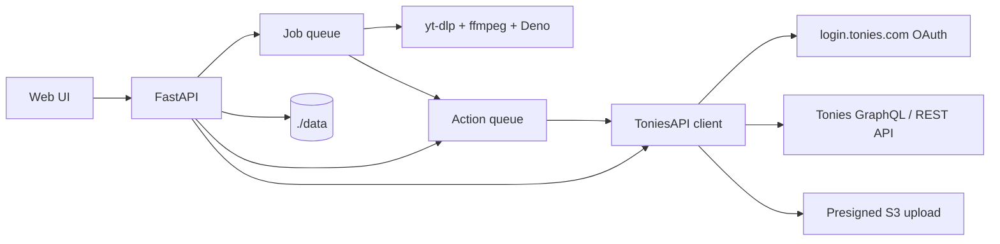

# App Overview

Tonies-YT is a small web app for moving audio onto Creative Tonies. It talks to the Tonies cloud directly over HTTPS; no browser is involved.

## Primary flow
1. Search YouTube.
2. Pick a result.
3. Download audio with yt-dlp and ffmpeg.
4. Upload through the Tonies cloud API.
5. The library shows the new track right away and updates when Tonies finishes processing it.

## UX model

### Search
- Latest search only, with configurable result count: 5 / 10 / 15 / 20
- Realtime updates with SSE and clear progress states
- Search status appears in the Results pane
- Starting a new search can replace an in-flight search request

### Tonies library
- Rename, reorder and delete tracks
- Delete all content **with confirmation**
- Drag local files onto the selected Tonie
- Visible row Actions menus and keyboard/touch alternatives; desktop right-click remains an optional shortcut
- Up to three local transfers in parallel; attachments retain submitted order and the captured destination
- Shows free/used minutes

### Settings
- Change app password
- Update Tonies account credentials
- View installed tool versions
- Tool updates are managed outside the UI: rebuild/recreate the Docker image, or update the native Python environment and restart. The app does not install packages at runtime.

## Architecture

`ToniesAPI` (`app/tonies_api.py`, with `app/tonies_session.py` for the login and `app/tonies_content.py` for reads) owns all Tonies traffic:
- **Auth:** OAuth password grant, refresh in memory, one re-login if the refresh is rejected.
- **Reads:** households, Creative Tonies and their chapters via one GraphQL query.
- **Writes (`apply`):** one read, a batch of edits planned by chapter ID, one PATCH of the full chapter list over REST, one read-back until it matches. Unknown outcomes are never retried.
- **Uploads:** `prepare_upload` allocates a file ID and streams the file to the presigned S3 form (no bearer token); `apply` attaches it at the requested position and confirms it by its server-assigned ID.

`app/actions.py` queues every library change per Tonie and applies them in batches; uploads transfer three at a time in parallel and attach in queue order. `app/tonies_batch.py` is the pure planner that turns a list of changes into one chapter list. The page (`web/assets/tonie-actions.js`) shows queued changes at once by layering them on the last server content, and settles on the `tonies_actions` events. See [Operations](OPERATIONS.md#tonies-tokens-and-queued-writes).

`app/auth.py` guards everything else: per-browser session cookies, sign-in throttling and cross-site write checks (see [Operations](OPERATIONS.md#app-sign-in-and-sessions)).

`app/uploader.py` is the thin app-facing layer: it keeps one client per account and resets it when the vault locks or credentials change.

## Code map

Each area has its own small, named file; most start with a one-line comment saying what they own. `tests/test_no_monoliths.py` keeps every file in `app/`, `web/` and `web/assets/` at 400 lines or fewer and every Python or JS function at 100 lines or fewer.

### Server: app start and pages
- `app/__init__.py`: the app version
- `app/main.py`: builds the FastAPI app: start-up and shutdown, security middleware, error handling and the routers
- `app/config.py`: settings read from the environment (Tonies account override, data folder, allowed hosts, public URL, upload limit, logging)
- `app/logger.py`: log setup (rotating log file, quiet HTTP client logs)
- `app/web_pages.py`: serves an HTML page with the shared version footer added

### Server: HTTP routes (`app/routes/`)
- `app/routes/__init__.py`: package marker for the routers
- `app/routes/setup.py`: health, first-run setup, sign-in, Lock, password and Tonies account changes, tool versions
- `app/routes/pages.py`: the HTML pages (workspace, Settings, Logs, Sign-in, Setup), the old `/account` redirect and the favicon
- `app/routes/jobs.py`: searches, picking one or several results, fetching a result for the editor, cancelling jobs
- `app/routes/files.py`: Local files: list, import, play/download, waveform, clip, delete, add to a Tonie
- `app/routes/tonies.py`: Creative Tonies list, track list reads, queued changes, Undo and the older single-change endpoints
- `app/routes/events.py`: the server-sent event stream, its statistics and the log viewer routes

### Server: sign-in and security
- `app/auth.py`: per-browser sessions, sign-in throttling and cross-site write checks
- `app/request_security.py`: Host and Origin checks and request body size limits
- `app/credentials.py`: the password-protected vault holding the app login and the encrypted Tonies credentials
- `app/vault_storage.py`: private, atomic reads and writes of the vault files

### Server: search and download jobs
- `app/models.py`: request and job data models
- `app/ai.py`: turns a typed search or link into a job request (plain rules, no AI service)
- `app/youtube_source.py`: checks and normalises YouTube video and playlist input
- `app/job_store.py`: job state, saving to disk, job events, cancelling, expiry and the stuck-job watchdog
- `app/job_pipeline.py`: running a search, picking results, the download pool (three at a time) and editor fetches
- `app/job_upload.py`: handing a finished download to the Tonie queue and following it to the end
- `app/attach_order.py`: hands parallel downloads to the Tonie queue in list order
- `app/downloader.py`: yt-dlp commands for search, playlists and downloads (one retry for a plain failure)
- `app/events.py`: the shared event list behind `/api/events`, for jobs and Tonies changes

### Server: audio and Local files
- `app/media_files.py`: the Local files library: safe file names, imports, waveforms and clips
- `app/media_process.py`: ffmpeg/ffprobe work: the one MP3 encoder (with volume levelling), waveform outlines, lossless clips and durations
- `app/subprocess_runner.py`: runs a child process with a deadline and bounded output, and cleans it up

### Server: Tonies cloud
- `app/uploader.py`: the app-facing Tonies operations; keeps one client per account and resets it when the vault locks or credentials change
- `app/actions.py`: the per-Tonie queue of library changes and uploads, applied in batches
- `app/tonies_batch.py`: plans a batch of edits as one chapter list (pure, no I/O)
- `app/undo.py`: the server-side Undo recipes for rename, move and a new upload
- `app/tonies_api.py`: the `ToniesAPI` client: uploads, guarded batch writes and Undo writes
- `app/tonies_content.py`: Tonie URLs, reading the Tonies and their tracks, and checking a write by reading it back
- `app/tonies_session.py`: the in-memory Tonies login, token refresh and HTTP session

### Page markup (`web/`)
- `web/index.html`: the audio workspace markup, plus `<link>` and `<script src>` tags only
- `web/login.html`, `web/setup.html`, `web/account.html` (Settings), `web/logs.html`: the other pages

### Page scripts (`web/assets/*.js`)

Plain scripts, no framework or build step, loaded in the order `index.html` lists them. They only declare things; an area that wires up events has an `init...()` function, and `app-boot.js` (loaded last) calls them all.

Shared:
- `theme.js`: applies the saved light/dark choice before the first paint (every page)
- `session.js`: sends the browser to sign-in when its session ends (every signed-in page)
- `app-state.js`: page element references and caches that several areas read
- `app-core.js`: small shared helpers: escaping, formatting, the API call, toasts, status lines and Lock
- `workspace-storage.js`: browser storage for cached files, Tonies, track lists and view settings
- `workspace-dialogs.js`: one confirmation dialog at a time, with focus on the safe choice
- `context-menus.js`: the right-click / long-press menus for tracks and Local files
- `app-boot.js`: starts the page: calls each area's `init...()`, restores caches and loads live data (loaded last)

Layout and navigation:
- `workspace-navigation.js`: views (Tracks, Add audio, Activity), the YouTube / Local files tabs, the chosen Tonie's header and appearance
- `tonies-picker.js`: the list of Creative Tonies, their artwork and choosing one

Tracks:
- `tonie-library.js`: the chosen Tonie's track list: loading it, status, edit mode and polling while tracks process
- `tonie-library-render.js`: draws the track list and binds its events (drag to reorder, double-tap, menu, rename, select)
- `tonie-library-rows.js`: HTML for capacity, empty and loading states, track rows and upload placeholders
- `workspace-tracks.js`: selecting tracks by ID and the inline rename editors
- `tonie-actions.js`: changes queued on the server (delete, move, rename, upload position), shown on top of the last read list
- `workspace-undo.js`: the Undo button for the latest change (the server decides what can be undone)

Add audio (YouTube):
- `search-results.js`: sending a search, drawing results and picking a result
- `search-model.js`: which searches and results show, and in what state
- `workspace-source-selection.js`: picking one result once, so a lost reply never offers a second Add
- `workspace-youtube-selection.js`: selecting several results (or playlist videos) and adding them in one request
- `workspace-audio-editor.js`: the waveform editor: play, drag the start and end, clip and add

Add audio (Local files):
- `local-files.js`: the Local files list: drawing, refreshing, downloading and deleting files
- `workspace-sources.js`: selecting several Local files, importing a file, and drawing one YouTube result card
- `local-uploads.js`: the queue that adds Local files to a Tonie
- `local-preview.js`: the one in-browser player for Local files

Activity and live updates:
- `upload-tracking.js`: follows an upload from the app to the Tonie until the track is confirmed there
- `workspace-jobs.js`: keeps the page's job list in step with the server and reacts to job changes
- `workspace-activity.js`: the Activity list of this session's jobs and changes
- `realtime.js`: live updates over server-sent events, polling as the fallback, and health checks

### Stylesheets (`web/assets/*.css`)

`index.html` links the workspace stylesheets in this order (the order matters for the cascade):
- `theme.css`: colour tokens (light, dark, system), base controls and the app header, shared by every page
- `layout.css`: the workspace shell, header and overall layout
- `tracks.css`: track lists, Local files and workspace controls
- `search-results.css`: YouTube search results and the Activity view
- `editor.css`: the audio editor dialog and clip controls
- `dialogs.css`: dialogs, toasts and notices
- `responsive.css`: tablet and phone layout
- `tonie-art.css`: Tonie artwork and the Tonie picker
- `empty-states.css`: empty states
- `candidate-cards.css`: YouTube result cards
- `footer.css`: footer spacing and reduced-motion overrides

Other stylesheets:
- `pages.css`: Settings, Logs, Sign-in and Setup layouts (with `theme.css`)
- `page-footer.css`: the version footer that `app/web_pages.py` adds to every page

## Important data

Stored under `DATA_DIR` (`./data` natively, `/app/data` in Compose's project-scoped named volume; old host binds need explicit migration):
- `downloads/`: local audio library
- `logs/`: application log (`toni-auto.log` with `.env.example`)
- `jobs-state.json`: the latest 200 jobs. Jobs that were mid-flight at shutdown are marked failed on the next start.
- `secrets/vault-meta.json`, `secrets/vault-credentials.enc`: app login and encrypted Tonies credentials

Kept in memory only:
- sign-in sessions
- the unlocked Tonies credentials
- OAuth access and refresh tokens
- the live job queue and event stream

## Important endpoints

### Core
- `GET /api/health`
- `POST /api/chat`
- `GET /api/jobs`
- `POST /api/jobs/{job_id}/select`

### Tonies library
- `POST /api/tonies-actions`: queue changes (`delete`, `rename`, `move`, `clear`) for one Tonie
- `GET /api/tonies-actions`: recent changes and their status
- `POST /api/tonies-actions/{action_id}/undo`: reverse the server-owned latest submission, or cancel a pending removal before commitment; no client snapshot/body is required. Success returns `actions` plus optional confirmed `content`; refusal is `409` with `needs_refresh: true`. Committed deletions/Clear all have no recovery guarantee.
- `POST /api/tonies-content`
- `POST /api/tonies-content/delete`
- `POST /api/tonies-content/delete-all`
- `POST /api/tonies-content/reorder`
- `POST /api/tonies-content/rename`

The single-change endpoints below `tonies-content` predate the queue and still work; the app itself uses `tonies-actions`. Rename, reorder and delete take the `chapter_id` the UI is acting on. Delete follows that ID if the chapter has moved; rename and reorder refuse if it is no longer at the given index. All three refuse if the ID is gone.

### Files
- `GET /api/files`
- `GET /api/files/{filename}`: authenticated download; `?inline=true` enables local preview with HTTP range support
- `POST /api/files/upload`: bounded local audio import/conversion
- `DELETE /api/files/{filename}`
- `POST /api/upload-existing`

### Setup/auth

Every endpoint except health and the first four below needs a signed-in session.

- `GET /api/setup/status`
- `POST /api/setup/init`
- `POST /api/setup/login`
- `POST /api/setup/lock`
- `POST /api/setup/change-password`
- `POST /api/setup/update-tonies-credentials`
- `POST /api/setup/update-yt-dlp`: compatibility-only refusal; runtime installation is disabled and the UI offers no updater.
