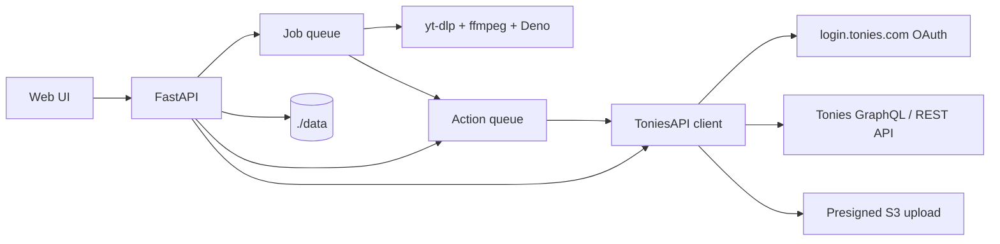

# App Overview

Tonies-YT is a small web app for moving audio onto Creative Tonies. It talks to the Tonies cloud directly over HTTPS; no browser is involved.

## Primary flow
1. Search YouTube.
2. Pick a result.
3. Download audio with yt-dlp and ffmpeg.
4. Upload through the Tonies cloud API.
5. The library shows the new track right away and updates when Tonies finishes processing it.

## UX model

### Search
- Latest search only, with configurable result count: 5 / 10 / 15 / 20
- Realtime updates with SSE and clear progress states
- Search status appears in the Results pane
- Starting a new search can replace an in-flight search request

### Tonies library
- Rename, reorder and delete tracks
- Delete all content **with confirmation**
- Drag local files onto the selected Tonie
- Visible row Actions menus and keyboard/touch alternatives; desktop right-click remains an optional shortcut
- Up to three local transfers in parallel; attachments retain submitted order and the captured destination
- Shows free/used minutes

### Settings
- Change app password
- Update Tonies account credentials
- View installed tool versions
- Tool updates are managed outside the UI: rebuild/recreate the Docker image, or update the native Python environment and restart. The app does not install packages at runtime.

## Architecture

`ToniesAPI` (`app/tonies_api.py`) owns all Tonies traffic:
- **Auth:** OAuth password grant, refresh in memory, one re-login if the refresh is rejected.
- **Reads:** households, Creative Tonies and their chapters via one GraphQL query.
- **Writes (`apply`):** one read, a batch of edits planned by chapter ID, one PATCH of the full chapter list over REST, one read-back until it matches. Unknown outcomes are never retried.
- **Uploads:** `prepare_upload` allocates a file ID and streams the file to the presigned S3 form (no bearer token); `apply` attaches it at the requested position and confirms it by its server-assigned ID.

`app/actions.py` queues every library change per Tonie and applies them in batches; uploads transfer three at a time in parallel and attach in queue order. `app/tonies_batch.py` is the pure planner that turns a list of changes into one chapter list. The page (`web/index.html`) shows queued changes at once by layering them on the last server content, and settles on the `tonies_actions` events. See [Operations](OPERATIONS.md#tonies-tokens-and-queued-writes).

`app/auth.py` guards everything else: per-browser session cookies, sign-in throttling and cross-site write checks (see [Operations](OPERATIONS.md#app-sign-in-and-sessions)).

`app/uploader.py` is the thin app-facing layer: it keeps one client per account and resets it when the vault locks or credentials change.

## Code map

### Backend
- `app/main.py`: routes and API
- `app/auth.py`: sign-in sessions and request guard
- `app/jobs.py`: search/download jobs; uploads hand over to the action queue
- `app/actions.py`: per-Tonie queue of library changes, applied in batches
- `app/tonies_batch.py`: batch planner (pure, no I/O)
- `app/events.py`: event stream for `/api/events`
- `app/tonies_api.py`: Tonies OAuth/HTTP client
- `app/uploader.py`: app-facing Tonies operations
- `app/downloader.py`: YouTube search/download
- `app/credentials.py`: encrypted local vault and app login
- `app/config.py`: environment config
- `app/request_security.py`: Host/origin parsing and trust policy
- `app/media_files.py`: bounded imports, regular-file policy and restricted audio conversion
- `app/vault_storage.py`: private atomic vault file storage
- `app/youtube_source.py`: YouTube-only source normalization
- `app/subprocess_runner.py`: bounded subprocess output, deadline and process cleanup
- `app/web_pages.py`: shared server-rendered version footer using the running app version

### Frontend
- `web/index.html`: main app UI
- `web/login.html`: login page
- `web/setup.html`: setup page
- `web/account.html`: settings page
- `web/logs.html`: logs page
- `web/assets/session.js`: sends the browser to sign-in when its session ends
- `web/assets/workspace-*.js`: focused navigation, source, track, Activity and dialog behavior
- `web/assets/local-preview.js`: one persistent authenticated local player
- `web/assets/theme.css`, `theme.js`: shared theme tokens, base controls and app header for every page
- `web/assets/workspace.css`: responsive workspace layout
- `web/assets/pages.css`: Settings, Logs, Sign-in and Setup layouts

## Important data

Stored under `DATA_DIR` (`./data` natively, `/app/data` in Compose's project-scoped named volume; old host binds need explicit migration):
- `downloads/`: local audio library
- `logs/`: application log (`toni-auto.log` with `.env.example`)
- `jobs-state.json`: the latest 200 jobs. Jobs that were mid-flight at shutdown are marked failed on the next start.
- `secrets/vault-meta.json`, `secrets/vault-credentials.enc`: app login and encrypted Tonies credentials

Kept in memory only:
- sign-in sessions
- the unlocked Tonies credentials
- OAuth access and refresh tokens
- the live job queue and event stream

## Important endpoints

### Core
- `GET /api/health`
- `POST /api/chat`
- `GET /api/jobs`
- `POST /api/jobs/{job_id}/select`

### Tonies library
- `POST /api/tonies-actions`: queue changes (`delete`, `rename`, `move`, `clear`) for one Tonie
- `GET /api/tonies-actions`: recent changes and their status
- `POST /api/tonies-actions/{action_id}/undo`: reverse the server-owned latest submission, or cancel a pending removal before commitment; no client snapshot/body is required. Success returns `actions` plus optional confirmed `content`; refusal is `409` with `needs_refresh: true`. Committed deletions/Clear all have no recovery guarantee.
- `POST /api/tonies-content`
- `POST /api/tonies-content/delete`
- `POST /api/tonies-content/delete-all`
- `POST /api/tonies-content/reorder`
- `POST /api/tonies-content/rename`

The single-change endpoints below `tonies-content` predate the queue and still work; the app itself uses `tonies-actions`. Rename, reorder and delete take the `chapter_id` the UI is acting on. Delete follows that ID if the chapter has moved; rename and reorder refuse if it is no longer at the given index. All three refuse if the ID is gone.

### Files
- `GET /api/files`
- `GET /api/files/{filename}`: authenticated download; `?inline=true` enables local preview with HTTP range support
- `POST /api/files/upload`: bounded local audio import/conversion
- `DELETE /api/files/{filename}`
- `POST /api/upload-existing`

### Setup/auth

Every endpoint except health and the first four below needs a signed-in session.

- `GET /api/setup/status`
- `POST /api/setup/init`
- `POST /api/setup/login`
- `POST /api/setup/lock`
- `POST /api/setup/change-password`
- `POST /api/setup/update-tonies-credentials`
- `POST /api/setup/update-yt-dlp`: compatibility-only refusal; runtime installation is disabled and the UI offers no updater.
