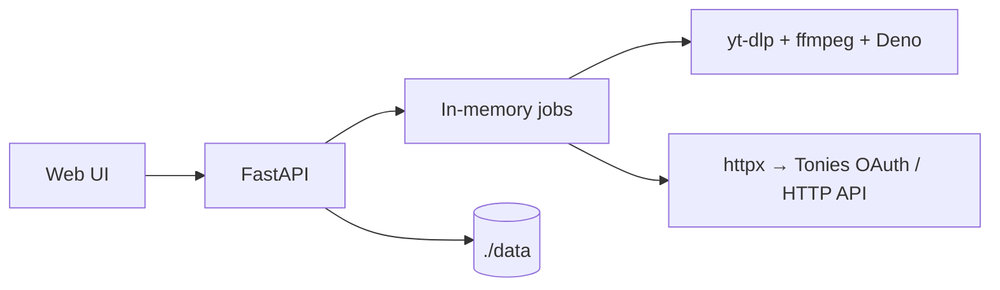

# App Overview — API-only branch

Tonies-YT is a small web app for moving audio onto Creative Tonies. This branch replaces browser automation with direct OAuth and Tonies HTTP API calls; documentation of this branch does not mean the running production app has been migrated.

## Primary flow
1. Search YouTube.
2. Pick a result.
3. Download audio with yt-dlp and ffmpeg.
4. Upload through the Tonies cloud API and wait for processing.
5. Sync the Tonies library view.

## UX model

### Search
- Latest search only, with configurable result count: 5 / 10 / 15 / 20
- Realtime updates with SSE and clear progress states
- Search status appears in the Results pane
- Starting a new search can replace an in-flight search request

### Tonies library
- Rename, reorder and delete tracks
- Delete all content **with confirmation**
- Drag local files onto the selected Tonie
- Desktop right-click menu: upload / upload to top / upload to bottom
- Multiple local uploads processed sequentially
- Shows free/used minutes

### Settings
- Change app password
- Update Tonies account credentials
- View installed tool versions
- Update yt-dlp from the UI when available

## Architecture

No Playwright/Chromium runtime or browser session is required. YouTube extraction and audio conversion remain separate from the Tonies transport and retain ffmpeg + Deno tooling.

Tonies access/refresh tokens and renewal state are process-local and renewed in memory. On restart the next Tonies operation uses available account credentials to authenticate again. This is not durable refresh-token storage or an indefinite login guarantee.

## Code map

### Backend
- `app/main.py` — routes and API
- `app/jobs.py` — job flow and retries
- `app/uploader.py` — app-facing Tonies operations
- `app/downloader.py` — YouTube search/download
- `app/credentials.py` — encrypted local account vault and app login
- `app/config.py` — environment config

### Frontend
- `web/index.html` — main app UI
- `web/login.html` — login page
- `web/setup.html` — setup page
- `web/account.html` — settings page
- `web/logs.html` — logs page

## Important data

Stored under `DATA_DIR` (`./data` on the native host, `/app/data` in Compose):
- `downloads/` — local audio library
- `logs/` — configured application log (`toni-auto.log` with `.env.example`)
- `secrets/vault-meta.json` and `secrets/vault-credentials.enc` — app vault metadata and encrypted Tonies account credentials
- App settings and other existing runtime data

Not persisted:
- In-memory job queue/state
- Unlocked vault credentials
- OAuth access/refresh tokens and renewal state

The existing account credential model is unchanged: encrypted app vault by default, or `TONIES_EMAIL` / `TONIES_PASSWORD` environment overrides. A restart needs vault unlock again unless environment credentials are configured. `tonies-storage-state.json` and browser selector settings are obsolete, not substitutes for the vault.

## Important endpoints

### Core
- `GET /api/health`
- `POST /api/chat`
- `GET /api/jobs`
- `POST /api/jobs/{job_id}/select`

### Tonies library
- `POST /api/tonies-content`
- `POST /api/tonies-content/delete`
- `POST /api/tonies-content/delete-all`
- `POST /api/tonies-content/reorder`
- `POST /api/tonies-content/rename`

### Files
- `GET /api/files`
- `DELETE /api/files/{filename}`
- `POST /api/upload-existing`

### Setup/auth
- `GET /api/setup/status`
- `POST /api/setup/init`
- `POST /api/setup/login`
- `POST /api/setup/lock`
- `POST /api/setup/change-password`
- `POST /api/setup/update-tonies-credentials`
- `POST /api/setup/update-yt-dlp`

## Acceptance boundary

Standalone HTTP acceptance used owned disposable chapters, read back mutations and verified original content/order preservation. That is transport evidence, not proof this UI/job integration has been deployed. Live clear-to-empty was excluded to preserve existing libraries. Its confirmed UI feature remains, but testing it requires a separately authorized empty/spare target.
