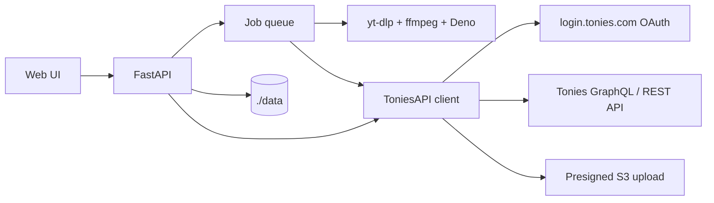

# App Overview

Tonies-YT is a small web app for moving audio onto Creative Tonies. It talks to the Tonies cloud directly over HTTPS; no browser is involved.

## Primary flow
1. Search YouTube.
2. Pick a result.
3. Download audio with yt-dlp and ffmpeg.
4. Upload through the Tonies cloud API.
5. The library shows the new track right away and updates when Tonies finishes processing it.

## UX model

### Search
- Latest search only, with configurable result count: 5 / 10 / 15 / 20
- Realtime updates with SSE and clear progress states
- Search status appears in the Results pane
- Starting a new search can replace an in-flight search request

### Tonies library
- Rename, reorder and delete tracks
- Delete all content **with confirmation**
- Drag local files onto the selected Tonie
- Desktop right-click menu: upload / upload to top / upload to bottom
- Multiple local uploads processed one at a time
- Shows free/used minutes

### Settings
- Change app password
- Update Tonies account credentials
- View installed tool versions
- Update yt-dlp from the UI when available

## Architecture

`ToniesAPI` (`app/tonies_api.py`) owns all Tonies traffic:
- **Auth:** OAuth password grant, refresh in memory, one re-login if the refresh is rejected.
- **Reads:** households, Creative Tonies and their chapters via one GraphQL query.
- **Writes:** re-read, check the expected chapter ID, PATCH the full chapter list over REST, read back until it matches. Unknown outcomes are never retried.
- **Uploads:** allocate a file ID, stream the file to the presigned S3 form (no bearer token), add the chapter at the requested position, then confirm it by its server-assigned ID.

`app/uploader.py` is the thin app-facing layer: it keeps one client per account and resets it when the vault locks or credentials change.

## Code map

### Backend
- `app/main.py`: routes and API
- `app/jobs.py`: search/download/upload job queue (one upload at a time)
- `app/tonies_api.py`: Tonies OAuth/HTTP client
- `app/uploader.py`: app-facing Tonies operations
- `app/downloader.py`: YouTube search/download
- `app/credentials.py`: encrypted local vault and app login
- `app/config.py`: environment config

### Frontend
- `web/index.html`: main app UI
- `web/login.html`: login page
- `web/setup.html`: setup page
- `web/account.html`: settings page
- `web/logs.html`: logs page

## Important data

Stored under `DATA_DIR` (`./data` natively, `/app/data` in Compose):
- `downloads/`: local audio library
- `logs/`: application log (`toni-auto.log` with `.env.example`)
- `jobs-state.json`: the latest 200 jobs. Jobs that were mid-flight at shutdown are marked failed on the next start.
- `secrets/vault-meta.json`, `secrets/vault-credentials.enc`: app login and encrypted Tonies credentials

Kept in memory only:
- the unlocked Tonies credentials
- OAuth access and refresh tokens
- the live job queue and event stream

## Important endpoints

### Core
- `GET /api/health`
- `POST /api/chat`
- `GET /api/jobs`
- `POST /api/jobs/{job_id}/select`

### Tonies library
- `POST /api/tonies-content`
- `POST /api/tonies-content/delete`
- `POST /api/tonies-content/delete-all`
- `POST /api/tonies-content/reorder`
- `POST /api/tonies-content/rename`

Rename, reorder and delete take the `chapter_id` the UI is acting on. Delete follows that ID if the chapter has moved; rename and reorder refuse if it is no longer at the given index. All three refuse if the ID is gone.

### Files
- `GET /api/files`
- `DELETE /api/files/{filename}`
- `POST /api/upload-existing`

### Setup/auth
- `GET /api/setup/status`
- `POST /api/setup/init`
- `POST /api/setup/login`
- `POST /api/setup/lock`
- `POST /api/setup/change-password`
- `POST /api/setup/update-tonies-credentials`
- `POST /api/setup/update-yt-dlp`
